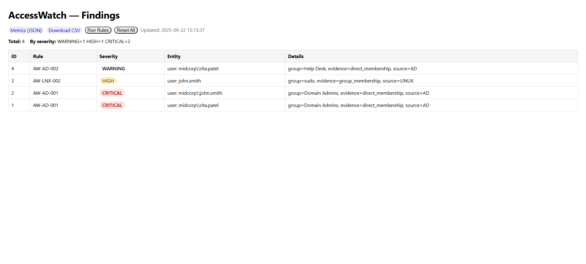
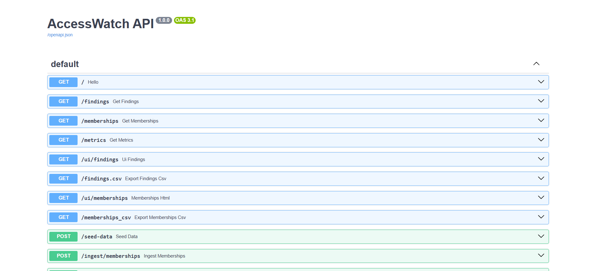
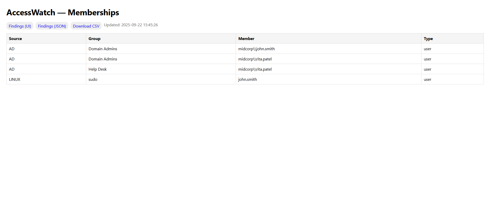

# AccessWatch
**Identity & Access Monitoring Platform**

AccessWatch ingests identity group memberships from Active Directory and Linux systems, applies security rules to detect privilege escalation risks, and presents findings through a clean web interface.



## Problem Statement

Small to medium organizations often lack visibility into identity sprawl across their infrastructure. Questions like "Who has Domain Admin access?" or "Which users have both help desk and administrative privileges?" require manual auditing across multiple systems.

AccessWatch provides centralized visibility into identity relationships and automatically flags common security risks.

## Features

- **Multi-source ingestion**: CSV import from Active Directory and Linux systems
- **Security rules engine**: Detects Domain Admin membership, sudo access, and segregation of duties violations
- **Web dashboard**: Clean interface with severity-based color coding and filtering
- **Data export**: CSV export functionality for further analysis
- **RESTful API**: JSON endpoints for programmatic access

## Architecture

```
CSV Data → Ingestion API → SQLite Database → Rules Engine → Findings Dashboard
     ↓           ↓              ↓             ↓              ↓
- AD Groups   - Validation   - Memberships  - AW-AD-001   - Severity badges
- Linux sudo  - Deduplication- Findings     - AW-LNX-002  - CSV export  
              - Error handling                - AW-AD-002   - One-click rules
```

## Quick Start

### Prerequisites
- Python 3.9+
- pip

### Installation

```bash
# Clone the repository
git clone https://github.com/doitformyset/accesswatch.git
cd accesswatch

# Create virtual environment (Windows)
python -m venv .venv
.venv\Scripts\activate

# Install dependencies
pip install -r requirements.txt

# Start the server
uvicorn api.main:app --reload
```

### Access Points

- **Web Dashboard**: http://127.0.0.1:8000/ui/findings
- **API Documentation**: http://127.0.0.1:8000/docs
- **JSON API**: http://127.0.0.1:8000/findings

## Usage

### 1. Data Ingestion

Upload a CSV file with membership data via the web interface or API:

**Required CSV format:**
```csv
source,group_name,member_name,member_type
AD,Domain Admins,midcorp\john.smith,user
AD,Help Desk,midcorp\rita.patel,user
LINUX,sudo,john.smith,user
```

**Via API:**
```bash
curl -X POST "http://127.0.0.1:8000/ingest/memberships" \
  -H "Content-Type: multipart/form-data" \
  -F "file=@memberships.csv"
```

### 2. Run Security Rules

Click "Run Rules" in the web interface or call the API:

```bash
curl -X POST "http://127.0.0.1:8000/rules/run"
```

### 3. View Results

Access findings through:
- Web dashboard: `/ui/findings`
- JSON API: `/findings`
- CSV export: `/findings.csv`

## Security Rules

| Rule ID | Severity | Description |
|---------|----------|-------------|
| AW-AD-001 | CRITICAL | Domain Admin membership detection |
| AW-LNX-002 | HIGH | Linux sudo group membership |
| AW-AD-002 | WARNING | Help Desk group membership |

## API Endpoints

### Core Endpoints
- `GET /findings` - List all findings (JSON)
- `POST /ingest/memberships` - Upload membership CSV
- `POST /rules/run` - Execute all security rules
- `GET /metrics` - Summary statistics

### Web Interface
- `GET /ui/findings` - HTML dashboard
- `GET /ui/memberships` - View raw membership data

### Export
- `GET /findings.csv` - Download findings as CSV
- `GET /memberships.csv` - Download memberships as CSV

## Screenshots

### API Documentation

*Auto-generated Swagger/OpenAPI documentation*

### Membership View

*Raw membership data across all sources*

## Technology Stack

- **Backend**: FastAPI, SQLAlchemy, SQLite
- **Frontend**: Jinja2 templates, HTML/CSS
- **Data Processing**: Python CSV, Pandas-like operations
- **Deployment**: Uvicorn ASGI server

## Project Structure

```
accesswatch/
├── api/
│   ├── main.py          # FastAPI application and routes
│   └── db.py            # Database models and configuration
├── templates/
│   ├── findings.html    # Main dashboard template
│   └── memberships.html # Membership view template
├── docs/
│   └── *.png           # Screenshots for documentation
├── data/
│   └── *.csv           # Sample data files
├── requirements.txt     # Python dependencies
└── README.md           # This file
```

## Development

### Adding New Rules

Rules are currently defined in `api/main.py` within the `/rules/run` endpoint. Each rule:

1. Queries the memberships table for specific conditions
2. Creates findings with appropriate severity levels
3. Includes evidence details for audit trails

### Database Schema

**Memberships Table:**
- source (AD, LINUX, etc.)
- group_name 
- member_name
- member_type (user, group)

**Findings Table:**
- rule_id (AW-AD-001, etc.)
- severity (CRITICAL, HIGH, WARNING)
- entity_type/entity_name
- details (JSON evidence)

## Future Enhancements

- [ ] Docker containerization
- [ ] PowerShell Active Directory collector
- [ ] Linux system collector scripts
- [ ] YAML-based rule configuration
- [ ] Webhook notifications
- [ ] Multi-tenant support
- [ ] Historical trending

## Contributing

1. Fork the repository
2. Create a feature branch
3. Make changes with tests
4. Submit a pull request

## License

MIT License - see LICENSE file for details

---

